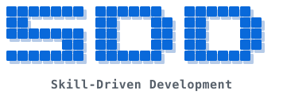

<div align="center">

<picture>
  <source media="(prefers-color-scheme: dark)" srcset="assets/logo-dark.svg">
  
</picture>

**Structured skill files, agent roles, and specification schemas for AI coding agents**  
*Spring Boot (Java & Kotlin) · Ktor · .NET · FastAPI · Django · REST APIs · Database · Testing · Agent Pipeline · Specs*

[](LICENSE)
[](#skills)
[](#agent-pipeline)
[](#supported-stacks)
[](#supported-stacks)
[](#supported-stacks)
[](#supported-stacks)
[](CONTRIBUTING.md)

</div>

## What is SDD?

SDD (Skill-Driven Development) gives AI agents persistent context via `.agent/` files and stack skills.

## Repository structure

SDD goes beyond static context: it includes **agent roles** (planner, architect, builder, tester, reviewer, conductor) that form a structured development pipeline, **specification schemas** for traceable requirements, and **quality gates** (DoR/DoD) that prevent incomplete work from moving forward.

> Compatible with Claude, GitHub Copilot, Cursor, Kiro, and any agent that reads markdown context files. Also installable as a native **Claude Code plugin** (see [Install](#install)).

```text
.claude-plugin/
├── plugin.json              # Claude Code plugin manifest
└── marketplace.json         # this repo doubles as its own plugin marketplace

commands/                    # Claude Code slash commands (/sdd:plan, /sdd:pipeline, ...)
├── plan.md
├── architect.md
├── implement.md
├── test.md
├── review.md
├── refactor.md
├── pipeline.md
└── bootstrap.md

skills/
├── spring-boot/             # each stack: SKILL.md (architecture, patterns) + testing.md
├── spring-boot-kotlin/
├── ktor/
├── android/
├── dotnet/
├── fastapi/
├── django/
└── shared/                  # one directory per skill (Claude Code plugin format)
    ├── api-design/SKILL.md
    ├── database/SKILL.md
    ├── security/SKILL.md
    ├── observability/SKILL.md
    ├── error-handling/SKILL.md
    ├── bootstrap/SKILL.md
    ├── refactor/SKILL.md          # independent
    ├── anti-invention/SKILL.md    # guardrails against hallucination
    ├── pattern-analysis/SKILL.md  # 3-example rule before generating
    ├── gap-analysis/SKILL.md      # requirement gap detection
    ├── spec-validation/SKILL.md   # spec completeness checks
    ├── dor/SKILL.md               # Definition of Ready gate
    └── dod/SKILL.md               # Definition of Done gate

agents/
├── planner.md               # requirement → plan.md + .spec.toon + .acceptance.toon (@planning)
├── architect.md             # spec → architecture.md + .contract.toon
├── builder.md               # contract/plan → production code (@implementation)
├── tester.md                # contract + code → test-plan.md + tests (@test-plan + @test)
├── reviewer.md              # code review + DoD (@review)
└── conductor.md             # pipeline orchestration

docs/
└── agents.md                # agent pipeline guide (installed as .agent/agents/README.md)

prompts/
├── endpoint.md              # generate REST endpoint
├── entity.md                # generate domain entity
├── service.md               # generate application service
├── repository-impl.md       # generate repository implementation
└── test-suite.md            # generate test suite

specs/
├── feature.schema.md        # .spec.toon schema
├── acceptance.schema.md     # .acceptance.toon schema
├── contract.schema.md       # .contract.toon schema
└── examples/                # reference specs (also CI fixtures)

examples/
└── create-order/            # full pipeline run: requirement → reviewer,
                             # every artifact in its role's format

scripts/
├── install.sh
├── install.ps1              # native Windows installer (same output as install.sh)
├── validate.sh
├── validate-spec.sh
└── new-skill.sh

templates/
├── spring-boot/SKILLS.md
├── dotnet/SKILLS.md
└── common/
    ├── context.md
    ├── architecture.md
    ├── decisions.md
    ├── conventions.md
    ├── runbook.md
    ├── glossary.md
    └── backlog_rules.md
```

## See it in action

[`examples/create-order/`](examples/create-order/) is a complete pipeline run
for one feature — from a one-paragraph requirement to reviewed code. Every
stage's artifacts are there in the exact format its agent role defines: plan +
TOON specs (planner), decisions doc + binding contract (architect), the 8
contracted source files (builder), test plan + one test per contracted
scenario (tester), and the reviewer's verdict. Five minutes of reading shows
you what SDD actually produces.

## Install

### Supported stacks

Pass one of these as the stack to any install option (`STACK=`, `-Stack`, or the installer's first argument):

| Stack | For | Built on |
|-------|-----|----------|
| `spring-boot` | ☕ Java | Spring Boot 4.x, Java 21+, JPA (Hibernate 7), Flyway, Jackson 3 |
| `spring-boot-kotlin` | 🟣 Kotlin | Spring Boot 4.x, Kotlin 2.2+, JPA, Flyway, MockK |
| `ktor` | 🟣 Kotlin | Ktor 3.x, Exposed, Koin, kotlinx.serialization, Flyway |
| `android` | 🤖 Kotlin | AGP 9 (built-in Kotlin), Jetpack Compose, Material 3, Hilt, Room, DataStore, WorkManager, multi-module Gradle |
| `dotnet` | 🔷 C# | .NET 10 (LTS), C# 14, ASP.NET Core 10, EF Core 10, MediatR |
| `fastapi` | 🐍 Python | FastAPI, Pydantic v2, async SQLAlchemy 2.0, Alembic |
| `django` | 🐍 Python | Django 5.x, Django REST Framework, pytest-django |

The shared skills (API design, database, security, errors, observability, quality gates) apply to every stack.

### Option 0: as a Claude Code plugin (recommended for Claude Code users)

```text
/plugin marketplace add valossa515/sdd
/plugin install sdd@sdd
```

This registers everything natively in Claude Code:

- **Skills** — all 15 skills (`sdd:api-design`, `sdd:security`, `sdd:dor`, ...) load on demand
- **Agents** — the pipeline roles become subagents (`sdd:planner`, `sdd:builder`, ...)
- **Commands** — the workflow becomes slash commands:

| Command | Role | What it does |
|---------|------|--------------|
| `/sdd:plan` | planner | Plan a feature — produces plan.md + .spec.toon + .acceptance.toon |
| `/sdd:architect` | architect | Turn a spec into an architecture contract (.contract.toon) |
| `/sdd:implement` | builder | Execute a plan/contract — production code only |
| `/sdd:test` | tester | Design the test strategy + write the tests |
| `/sdd:review` | reviewer | Structured review with 🔴🟡🔵 findings + DoD check |
| `/sdd:refactor` | refactor skill | Convention-aligned refactoring, no behavior change |
| `/sdd:pipeline` | conductor | Full pipeline with confirmation gates |
| `/sdd:bootstrap` | bootstrap skill | Create/update the `.agent/` context docs from your code and/or a description of the project |

The plugin works standalone, or together with a `.agent/` folder installed by the options below (commands read `.agent/SKILLS.md` overrides when present).

### Option 1: one-line install (curl)

```bash
bash <(curl -fsSL https://raw.githubusercontent.com/valossa515/sdd/main/scripts/install.sh) spring-boot
bash <(curl -fsSL https://raw.githubusercontent.com/valossa515/sdd/main/scripts/install.sh) dotnet

# pin a released version (recommended for teams):
bash <(curl -fsSL https://raw.githubusercontent.com/valossa515/sdd/main/scripts/install.sh) spring-boot . agent --ref v1.7.0
```

Releases are listed on the [releases page](https://github.com/valossa515/sdd/releases) with
their changelog; the installed `.agent/SKILLS.md` records which version it came from
(`sdd-version`).

### Option 2: install via `git clone` (recommended for teams)

```bash
git clone https://github.com/valossa515/sdd.git /tmp/sdd

# then pick ONE stack:
make -C /tmp/sdd install STACK=spring-boot TARGET=$(pwd)   # Spring Boot
make -C /tmp/sdd install STACK=dotnet      TARGET=$(pwd)   # .NET
```

### Option 3: run from local clone

```bash
make install STACK=spring-boot TARGET=$(pwd)
# full flow: all checks + install
make bootstrap STACK=spring-boot TARGET=$(pwd)
```

This creates a `.agent/` folder in your project with all relevant skills, ready to customize.

### Option 4: Windows (PowerShell)

`scripts/install.ps1` is a native installer: no bash, `make` or Git Bash needed. It runs on
Windows PowerShell 5.1 (built into Windows) and PowerShell 7+, needs only `git`, and produces
exactly the same files as the bash installer. From your project folder:

```powershell
& ([scriptblock]::Create((irm https://raw.githubusercontent.com/valossa515/sdd/main/scripts/install.ps1))) -Stack dotnet
```

| Parameter | Values | Default |
|-----------|--------|---------|
| `-Stack` | any [supported stack](#supported-stacks), e.g. `dotnet`, `fastapi` | required |
| `-Target` | path to your project | current folder |
| `-Format` | `agent`, `kiro` | `agent` |
| `-Ref` | tag or branch to install, e.g. `v1.7.0` (recommended for teams) | latest `main` |

From a local clone (`-ExecutionPolicy Bypass` applies to this one run only — Windows PowerShell
blocks local scripts by default):

```powershell
git clone https://github.com/valossa515/sdd.git $env:TEMP\sdd
powershell -ExecutionPolicy Bypass -File $env:TEMP\sdd\scripts\install.ps1 -Stack dotnet -Target .
```

Prefer bash? Inside a Git Bash terminal, Option 1 works as-is (Options 2 and 3 need `make`,
which Git Bash does not include).

Re-running either installer upgrades SDD in place: skills, agents, prompts and schemas are
refreshed, while your `.agent/SKILLS.md` (Project Overrides) and the context docs filled in by
`@bootstrap` are kept — only their `sdd-version` line is updated. Delete a file to reset it to the
template.

---

## How it works

```
your-project/
├── .agent/
│   ├── SKILLS.md              ← entry point: active skills and project overrides
│   ├── skills/
│   │   ├── spring-boot/
│   │   │   ├── SKILL.md       ← architecture, patterns, naming, DI rules
│   │   │   └── testing.md
│   │   └── shared/
│   │       ├── api-design/SKILL.md
│   │       ├── database/SKILL.md
│   │       ├── anti-invention/SKILL.md  ← guardrails against hallucination
│   │       ├── pattern-analysis/SKILL.md ← 3-example rule before generating
│   │       ├── gap-analysis/SKILL.md    ← requirement gap detection
│   │       ├── spec-validation/SKILL.md ← spec completeness checks
│   │       ├── dor/SKILL.md             ← Definition of Ready gate
│   │       └── dod/SKILL.md             ← Definition of Done gate
│   ├── agents/                    ← agent role definitions
│   │   ├── README.md              ← pipeline guide
│   │   ├── planner.md             ← requirement → plan + specs
│   │   ├── architect.md           ← spec → architecture decisions + contract
│   │   ├── builder.md             ← contract/plan → production code
│   │   ├── tester.md              ← contract + code → test plan + tests
│   │   ├── reviewer.md            ← code review + DoD verdict
│   │   └── conductor.md           ← pipeline orchestration
│   ├── plans/                     ← generated artifacts
│   │   ├── <feature>.md           ← plan document (planner)
│   │   ├── <feature>-architecture.md ← architecture decisions (architect)
│   │   └── <feature>-tests.md     ← test plan (tester)
│   ├── prompts/                   ← step-by-step generation guides
│   │   ├── endpoint.md
│   │   ├── entity.md
│   │   ├── service.md
│   │   ├── repository-impl.md
│   │   └── test-suite.md
│   └── specs/                     ← specification schemas
│       ├── features/              ← feature specs (.spec.toon)
│       ├── acceptance/            ← acceptance criteria (.acceptance.toon)
│       └── contracts/             ← architecture contracts (.contract.toon)
├── .github/
│   └── agents/                    ← Copilot custom agents (auto-generated)
│       ├── conductor.agent.md
│       ├── planner.agent.md
│       ├── architect.agent.md
│       ├── builder.agent.md
│       ├── tester.agent.md
│       └── reviewer.agent.md
├── src/
└── ...
```

**At task time**, the agent loads `.agent/SKILLS.md`, follows the links to the active skills, and generates code that respects:

- ✅ Your architecture (layered, Clean Arch, hexagonal)
- ✅ Your naming conventions
- ✅ Your testing patterns (JUnit 5, xUnit, Testcontainers)
- ✅ Your API design rules (REST, pagination, error format)
- ✅ Your database conventions (migrations, N+1 prevention, soft delete)
- ✅ Anti-invention guardrails (no hallucinated requirements)
- ✅ Quality gates (Definition of Ready / Definition of Done)

---

## Skills

| Skill | Stack | Description |
|-------|-------|-------------|
| [`spring-boot/SKILL`](skills/spring-boot/SKILL.md) | ☕ Spring Boot 4.x | Architecture, controllers, services, entities, DI, exception handling |
| [`spring-boot/testing`](skills/spring-boot/testing.md) | ☕ Spring Boot 4.x | JUnit, Mockito + `@MockitoBean`, MockMvc, RestTestClient, Testcontainers 2 |
| [`dotnet/SKILL`](skills/dotnet/SKILL.md) | 🔷 .NET 10 | Clean Architecture, CQRS/MediatR, FluentValidation, EF Core 10, built-in OpenAPI, library licensing |
| [`dotnet/testing`](skills/dotnet/testing.md) | 🔷 .NET 10 | xUnit v3, NSubstitute, WebApplicationFactory, Testcontainers, Respawn |
| [`spring-boot-kotlin/SKILL`](skills/spring-boot-kotlin/SKILL.md) | 🟣 Spring Boot + Kotlin | Kotlin idioms for Spring: null-safety, data-class DTOs, `@field:` validation, JPA entity rules |
| [`spring-boot-kotlin/testing`](skills/spring-boot-kotlin/testing.md) | 🟣 Spring Boot + Kotlin | JUnit 5, MockK, springmockk, MockMvc Kotlin DSL, Testcontainers |
| [`ktor/SKILL`](skills/ktor/SKILL.md) | 🟣 Ktor 3.x | Routes, plugins, Exposed + transactions, Koin, StatusPages RFC 7807, JWT |
| [`ktor/testing`](skills/ktor/testing.md) | 🟣 Ktor 3.x | MockK + runTest, testApplication, Testcontainers + Flyway |
| [`android/SKILL`](skills/android/SKILL.md) | 🤖 Android | Multi-module Gradle, pure Kotlin domain, Compose + ViewModel + UiState, Hilt, Room, DataStore, WorkManager, permissions |
| [`android/testing`](skills/android/testing.md) | 🤖 Android | JUnit 5 domain tests, MockK + Turbine ViewModel tests, Robolectric, Room, Compose UI and WorkManager tests |
| [`fastapi/SKILL`](skills/fastapi/SKILL.md) | 🐍 FastAPI | Routers, Depends, Pydantic v2, async SQLAlchemy 2.0, Alembic, RFC 7807 handlers |
| [`fastapi/testing`](skills/fastapi/testing.md) | 🐍 FastAPI | pytest-asyncio, httpx + dependency overrides, Testcontainers + Alembic |
| [`django/SKILL`](skills/django/SKILL.md) | 🐍 Django 5.x | Apps, services/selectors, DRF views and serializers, migrations, RFC 7807 handler |
| [`django/testing`](skills/django/testing.md) | 🐍 Django 5.x | pytest-django, factory_boy, APIClient, query-count assertions |
| [`shared/api-design`](skills/shared/api-design/SKILL.md) | All | REST conventions, pagination, RFC 7807 errors, OpenAPI |
| [`shared/database`](skills/shared/database/SKILL.md) | All | Flyway vs EF Migrations, N+1, projections, soft delete, indexing |
| [`shared/security`](skills/shared/security/SKILL.md) | All | Auth, CORS, input validation, secrets handling |
| [`shared/observability`](skills/shared/observability/SKILL.md) | All | Logging, tracing, metrics, health checks |
| [`shared/error-handling`](skills/shared/error-handling/SKILL.md) | All | Exception mapping, RFC 7807 problem details |
| [`shared/bootstrap`](skills/shared/bootstrap/SKILL.md) | All | Create/update project context docs in `.agent/` from the code and/or a description of what the project does |
| [`shared/refactor`](skills/shared/refactor/SKILL.md) | All | Convention-aligned refactoring without behavior changes |
| [`shared/anti-invention`](skills/shared/anti-invention/SKILL.md) | All | Guardrails against AI hallucination and scope creep |
| [`shared/pattern-analysis`](skills/shared/pattern-analysis/SKILL.md) | All | 3-example rule: study codebase before generating |
| [`shared/gap-analysis`](skills/shared/gap-analysis/SKILL.md) | All | Detect missing requirement info before writing specs |
| [`shared/spec-validation`](skills/shared/spec-validation/SKILL.md) | All | Validate spec completeness and consistency |
| [`shared/dor`](skills/shared/dor/SKILL.md) | All | Definition of Ready — 15-item pre-implementation gate |
| [`shared/dod`](skills/shared/dod/SKILL.md) | All | Definition of Done — 23-item completion checklist |

---

## Agent Pipeline

SDD includes six agent roles that form a structured development pipeline:

```
Requirement → planner → architect → builder → tester → reviewer
                              ↑ conductor orchestrates all ↑
```

| Role | File | Responsibility |
|------|------|----------------|
| **planner** | [agents/planner.md](agents/planner.md) | Convert requirement into feature spec + acceptance criteria |
| **architect** | [agents/architect.md](agents/architect.md) | Convert spec into architecture contract (layers, files, test strategy) |
| **builder** | [agents/builder.md](agents/builder.md) | Generate production code from contract or plan (`@implementation`) |
| **tester** | [agents/tester.md](agents/tester.md) | Design test strategy + generate tests (`@test-plan` + `@test`) |
| **reviewer** | [agents/reviewer.md](agents/reviewer.md) | Validate code against spec + contract + DoD (`@review`) |
| **conductor** | [agents/conductor.md](agents/conductor.md) | Orchestrate the full pipeline with confirmation gates |

Use the full pipeline for new features, or shortcut for simpler tasks:

| Task | Pipeline |
|------|----------|
| New feature | planner → architect → builder → tester → reviewer |
| Bugfix (clear spec) | architect → builder → tester → reviewer |
| Simple bugfix | builder → tester → reviewer |
| Refactor | builder → tester → reviewer |

See [docs/agents.md](docs/agents.md) for full documentation.

### Using agents in GitHub Copilot (VS Code)

When you install SDD, the script automatically creates `.github/agents/*.agent.md` files in your project. These are **custom agents** recognized natively by GitHub Copilot in VS Code.

After installation:

1. Open the Copilot Chat panel
2. Click the **agent dropdown** (where it says "Agent", "Ask", or "Plan")
3. You will see the SDD agents listed: **conductor**, **planner**, **architect**, **builder**, **tester**, **reviewer**
4. Select an agent and start chatting — it will follow its role instructions automatically

> **Tip:** If agents don't appear, reload the VS Code window (`Cmd+Shift+P` → `Developer: Reload Window`).

Each agent file includes the full role instructions plus a directive to read `.agent/SKILLS.md` before every task, so your project conventions are always respected.

---

## Specification Schemas

Specs create a traceability chain from requirement to code:

```
requirement → feature.spec.toon → acceptance.toon → contract.toon → code
```

| Schema | Purpose | Created by |
|--------|---------|------------|
| [feature.schema.md](specs/feature.schema.md) | Business behavior (inputs, outputs, business rules) for HTTP and non-HTTP features | planner |
| [acceptance.schema.md](specs/acceptance.schema.md) | Given/When/Then testable criteria | planner |
| [contract.schema.md](specs/contract.schema.md) | Files, layers, dependencies, test strategy | architect |

See [specs/README.md](specs/README.md) for full documentation.

---

## Action Prompts

Step-by-step generation guides for common artifacts:

| Prompt | Description |
|--------|-------------|
| [endpoint.md](prompts/endpoint.md) | Generate REST endpoint (controller + DTOs) |
| [entity.md](prompts/entity.md) | Generate domain entity with invariants |
| [service.md](prompts/service.md) | Generate application service / use case |
| [repository-impl.md](prompts/repository-impl.md) | Generate repository implementation |
| [test-suite.md](prompts/test-suite.md) | Generate test suite from test strategy |

See [prompts/README.md](prompts/README.md) for full documentation.

---

## Commands

```bash
make validate       # validates frontmatter + required context templates
make validate-specs # validates TOON spec files against the schemas
make install        # installs .agent/ for chosen stack
make bootstrap      # all checks + install in one flow
make update         # pull latest skills
make upgrade        # update + install (update SDD in an existing project)
make check          # validate + validate-specs + validate-agents
```

## Updating SDD

When a new version of SDD is released, you can update your project's `.agent/` folder in two ways:

### Option 1: upgrade from cloned repo (recommended)

If you cloned the SDD repo during initial install:

```bash
cd /path/to/sdd
git pull                # fetch latest version
make upgrade STACK=spring-boot TARGET=/path/to/your/project
```

`make upgrade` runs `update` (git pull) then `install` — replacing all skill, agent, prompt, and spec files in your project's `.agent/` folder while preserving your `SKILLS.md` overrides and the context docs (`context.md`, `architecture.md`, ...).

### Option 2: one-line reinstall (curl)

Re-run the install command to overwrite with the latest version:

```bash
bash <(curl -fsSL https://raw.githubusercontent.com/valossa515/sdd/main/scripts/install.sh) spring-boot /path/to/your/project
```

### Option 3: manual update

```bash
cd /path/to/sdd
git pull
make install STACK=spring-boot TARGET=/path/to/your/project
```

### What gets updated

| Artifact | Updated? | Notes |
|----------|----------|-------|
| `skills/shared/*` | ✅ Yes | Guardrails, DoR, DoD, etc. |
| `skills/<stack>/*` | ✅ Yes | Stack-specific skills |
| `agents/*` | ✅ Yes | Agent role definitions |
| `prompts/*` | ✅ Yes | Action prompt templates |
| `specs/*` | ✅ Yes | Specification schemas |
| `.github/agents/*` | ✅ Yes | Copilot custom agents (auto-generated) |
| `SKILLS.md` | ⚠️ Kept | Only the `sdd-version` line changes; Project Overrides stay |
| Context docs (`context.md`, `architecture.md`, ...) | ⚠️ Kept | Written by `@bootstrap`; only `sdd-version` changes if present |
| Your plans and specs (`plans/`, `specs/features/`, `specs/acceptance/`, `specs/contracts/`) | ❌ Never touched | Project-owned |

New skills or rows added to a stack template do not reach an existing `SKILLS.md`, because it is kept. Compare it with `templates/<stack>/SKILLS.md` after upgrading. To reset a project-owned file to the template, delete it and re-run the installer.

> **Tip:** Commit your current `.agent/` folder before upgrading, so the diff shows exactly what changed.

## How to use

After installation, your project will have `.agent/SKILLS.md`, agent definitions, and stack/shared skills.

### 1) Agent-driven workflow (recommended)

Use the agents directly — each one reads `.agent/SKILLS.md` automatically:

```text
# Full pipeline (new feature):
Act as the conductor defined in .agent/agents/conductor.md
Implement: order creation with validation and stock check

# Or invoke agents individually:
@planning
Plan the feature: user registration with email verification

@implementation
Execute the plan in .agent/plans/user-registration.md

@test
Write tests for the Order module following the testing skill.

@review
Review the changes in the current branch against main.

@refactor
Refactor the Order module to follow SKILL.md layer separation.
```

### 2) Direct skill references (supplementary)

You can also reference skills directly for targeted tasks:

```text
Read .agent/SKILLS.md.
Create endpoint POST /api/v1/orders following skills/shared/api-design/SKILL.md,
use validation and RFC 7807 errors.
```

```text
Read .agent/SKILLS.md.
Refactor Order module to respect skills/spring-boot/SKILL.md
and skills/shared/database/SKILL.md conventions.
```

### 3) Keep project-specific rules in `.agent/SKILLS.md`

In **Project Overrides**, add concrete rules such as:

- package/solution naming
- auth strategy
- migration paths
- non-functional constraints (timeouts, observability, etc.)

## How to use bootstrap (`@bootstrap`)

`@bootstrap` writes the project context that every agent reads before working — `context.md`,
`architecture.md`, `conventions.md`, `decisions.md`, `runbook.md`, `glossary.md`,
`backlog_rules.md`, `project-reference.md` and the Project Overrides in `SKILLS.md`.

It works from **two sources**, and you can give it either or both:

| Source | What it captures |
|--------|------------------|
| **Your code** — the agent scans the repository | What the system does *today*: modules, endpoints, database, conventions, build and test commands |
| **Your description of the project** — what you write after `@bootstrap` | *What the project is for*: the problem it solves, who uses it, main flows, business rules, constraints, domain terms — things the code rarely shows |

What you describe is recorded as given (it is never "improved" or filled in). Where the
description and the code disagree, bootstrap writes both down and flags the divergence instead
of picking one. Business sections it could not fill are left as `TODO` and listed at the end, so
you know what to describe.

### Existing project: map the code and say what it is for (recommended)

```text
@bootstrap
This is the inventory API for small retailers. Each company manages its own products
and stock movements; data must never leak between companies. Stock changes come from
the REST API and from Kafka commands sent by the company's ERP. A product's SKU is
unique per company. Out of scope: invoicing and the storefront.
```

### Existing project: map the code only

```text
@bootstrap
```

Problem, objectives, users and business constraints usually can't be read from code, so those
sections come back as `TODO`. Run `@bootstrap` again later with a description to fill them in —
only the business sections are updated, the rest is kept.

### New project (no code yet): define what it will do

Use bootstrap to write down what the project is meant to do *before* the first line of code, so
the planner starts from it:

```text
@bootstrap
New project, no code yet. A .NET 10 API for booking meeting rooms: employees book rooms
by time slot, admins manage rooms. A room can't be double-booked; bookings longer than
4 hours need admin approval. PostgreSQL, JWT authentication.
```

Everything that depends on code (class map, endpoints, schema) is marked `TODO: no code yet`,
and what the description plans is labelled **(planned)**, never presented as already built.

Write the description in any language. Re-run `@bootstrap` whenever the project's purpose or
rules change.

### `make bootstrap` vs `@bootstrap`

They are different steps:

- `make bootstrap STACK=<stack> TARGET=$(pwd)` runs SDD's checks and **installs** the `.agent/`
  folder with empty templates. It does not read your code or write any context.
- `@bootstrap`, in your AI agent's chat, **fills** those templates from your code and your
  description.

### Suggested routine per project

1. Install SDD (any option under [Install](#install)).
2. Run `@bootstrap` with a description of what the project does.
3. Review `.agent/SKILLS.md` → Project Overrides and `.agent/context.md`; fix anything the agent
   got wrong and answer the remaining `TODO`s.
4. Commit `.agent/` together with your code.

## Invocable commands

SDD includes 6 invocable workflow commands. Each is handled directly by its corresponding agent role:

### Feature flow: `@planning` → `@implementation`

| Command | Agent / Skill | Purpose |
|---------|---------------|----------|
| `@planning` | → **planner** agent | Design a feature — produces plan.md + .spec.toon + .acceptance.toon |
| `@implementation` | → **builder** agent | Execute a plan — implements tasks in order following conventions |

```text
@planning
Plan the feature: user registration with email verification

# After plan review:
@implementation
Execute the plan in .agent/plans/user-registration.md
```

### Test flow: `@test-plan` → `@test`

| Command | Agent / Skill | Purpose |
|---------|---------------|----------|
| `@test-plan` | → **tester** agent | Design testing strategy + produce test plan document |
| `@test` | → **tester** agent | Write all tests from the plan — unit, integration, edge cases |

```text
@test-plan
Plan tests for the Order module

# The tester agent handles both planning and writing:
@test
Write tests for the Order module following the testing skill.
```

### Independent skills: `@review` and `@refactor`

| Command | Agent / Skill | Purpose |
|---------|---------------|----------|
| `@review` | → **reviewer** agent | Structured code review with 🔴🟡🔵 severity classification |
| `@refactor` | [refactor.md](skills/shared/refactor/SKILL.md) | Restructure code to align with conventions without changing behavior |

```text
@review
Review the changes in the current branch against main.

@refactor
Refactor the Order module to follow skills/spring-boot/SKILL.md layer separation.
```

## Frontmatter required in all skills

Every skill markdown must include:

- `name`
- `description`
- `stack`
- `versions`

## ADR and glossary

Document architecture decisions in `decisions.md` (or `.agent/adr/adr-xxxx.md`) and keep domain terms in `glossary.md`.


## Troubleshooting: PR merge/diff issues

If a PR was merged with conflicts and your branch did not receive the README updates:

1. Confirm the latest commit contains README changes:
   - `git log --oneline -n 5`
   - `git show --name-only <commit_sha>`
2. Rebase your branch on the target branch (`main` or release branch).
3. If needed, cherry-pick the README commit:
   - `git cherry-pick <commit_sha>`
4. Re-run checks:
   - `make check`
5. Open README and confirm sections:
   - "How to use skills in your project"
   - "How to use bootstrap (`@bootstrap`)"

This helps guarantee onboarding docs are present after merge.

## License

MIT.
